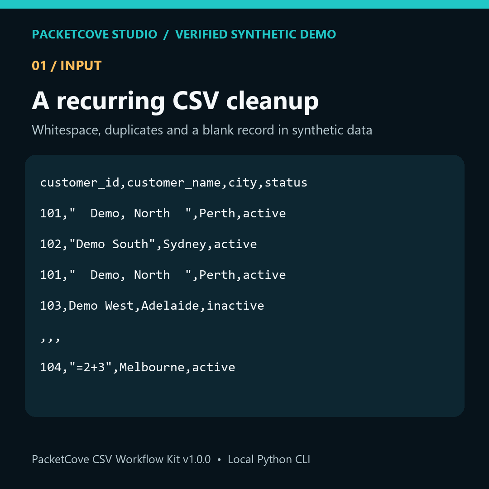

# PacketCove CSV Workflow Kit — synthetic demonstration

This repository shows one **verified, synthetic** run of [PacketCove CSV Workflow Kit](https://1220086224584.gumroad.com/l/cbgsrm), a **paid $15 USD** command-line Python product by PacketCove Studio. It is a showcase, not the toolkit download. The application source and buyer ZIP are not in this repository.

## The CSV problem

The sample export contains extra whitespace, a duplicate customer ID, an empty record and an inactive record. It also contains a formula-like text value to demonstrate the spreadsheet protection option. The names and records are invented.

| Input | Result |
|---|---|
| 6 data records | 3 output records |
| 1 empty record | removed |
| 1 duplicate record | removed |
| 1 inactive record | filtered by the example rule |
| 1 formula-like cell | prefixed with an apostrophe |

The real example uses JSON rules to trim whitespace, rename customer_id and customer_name, select columns, filter status=active, deduplicate by customer_id and enable formula protection. Formula protection **changes the output value** and should be checked against the target import workflow.

## Files

- [synthetic_input.csv](synthetic_input.csv) — original example input.
- [verified_output.csv](verified_output.csv) — CSV generated by the released v1.0.0 toolkit.
- [processing_report.json](processing_report.json) — generated report with counts and status.
- [before_after.png](before_after.png) and [cover.png](cover.png) — original PacketCove graphics based on the same synthetic example.
- [demo.gif](demo.gif) — 35-second designed sequence using the actual input, rules, generated output and report. The command frame summarizes a real local execution with shortened display paths; it is **not a terminal screen recording**.

## Verification

On 16 November 2026, PacketCove ran the source extracted from the final v1.0.0 buyer ZIP on Windows Python 3.12.14. The command exited 0. Its output matched the included expected CSV, and the report recorded 6 input rows, 1 empty removed, 1 duplicate removed, 1 filtered out, 0 invalid, 3 output and 1 formula cell protected. The input file was unchanged. These are example results, not a speed claim or a customer result.

The product processes UTF-8 CSV locally. It does not process Excel .xlsx files or include a cloud service or ongoing custom programming. Python 3.11+ is the intended runtime; Windows Python 3.12.14 and Linux Python 3.13.5 were tested. Python 3.11 and macOS have not been independently tested.

**Product:** [PacketCove CSV Workflow Kit — Clean, Validate and Report](https://1220086224584.gumroad.com/l/cbgsrm), $15 USD one-time. Check the product page and bundled licence before purchase.

Demo data and graphics © 2026 PacketCove Studio. No private customer data, credentials or paid application source are included.
